<div align="center">

# Hi, I’m Shaheer Mirza 👋

### Developer • Security enthusiast • Linux & DevOps learner

<a href="https://github.com/Shaheer-Mirza"></a>
<a href="https://www.linkedin.com/in/shaheer--mirza/"></a>
<a href="https://github.com/Shaheer-Mirza?tab=following"></a>


</div>

---

## ⚡ About me

I’m Shaheer Mirza — I enjoy turning curiosity into practical projects across web development, Linux, DevOps, security, automation, and space-focused experimentation. I like learning in public, documenting what I build, and improving my workflow along the way.

```text
Focus       Linux · DevOps · Security · Web · Open source
Build style Learn by doing · Document clearly · Improve continuously
Currently   Exploring practical tools, automation, and ambitious experiments
```

## 🚀 Selected work

<table>
<tr>
<td width="50%">
<h3>🌌 Space Biology Knowledge Engine</h3>
<p>A space-focused knowledge project built for exploration and discovery.</p>
<a href="https://github.com/Shaheer-Mirza/Space-Biology-Knowledge-Engine">Explore project →</a>
</td>
<td width="50%">
<h3>🐳 searxng-docker</h3>
<p>Docker Compose files for setting up a private SearXNG instance.</p>
<a href="https://github.com/Shaheer-Mirza/searxng-docker">Explore project →</a>
</td>
</tr>
<tr>
<td width="50%">
<h3>🐧 Setting Up Linux</h3>
<p>Practical shell automation and notes for preparing a Linux environment.</p>
<a href="https://github.com/Shaheer-Mirza/Setting-Up-Linux">Explore project →</a>
</td>
<td width="50%">
<h3>📚 Free DevOps Books</h3>
<p>A curated collection of free DevOps-related eBooks and learning resources.</p>
<a href="https://github.com/Shaheer-Mirza/Free-DevOps-Books-1">Explore collection →</a>
</td>
</tr>
</table>

<div align="center">
<a href="https://github.com/Shaheer-Mirza?tab=repositories"></a>
</div>

## 🏅 Achievements

### 🎓 Certifications & learning

<table>
<tr>
<td valign="top" width="33%"><p align="center">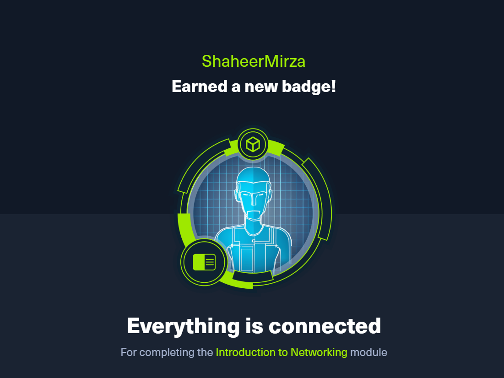</p><p align="center"><strong>HTB Introduction to Networking</strong><br><sub></sub></p></td>
<td valign="top" width="33%"><p align="center">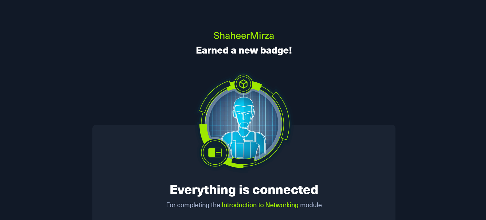</p><p align="center"><strong>HTB Introduction to Networking</strong><br><sub>Achievement badge</sub></p></td>
<td valign="top" width="33%"><p align="center">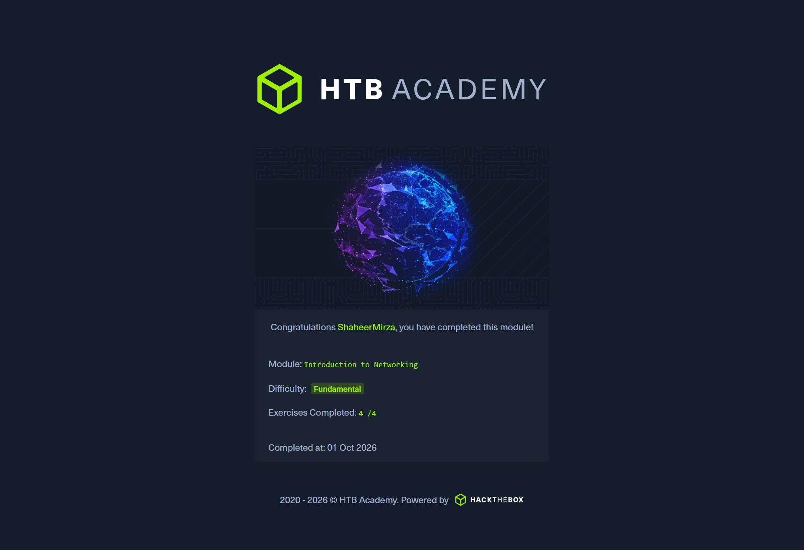</p><p align="center"><strong>HTB Introduction to Networking</strong><br><sub>Certificate</sub></p></td>
</tr>
<tr>
<td valign="top" width="33%"><p align="center">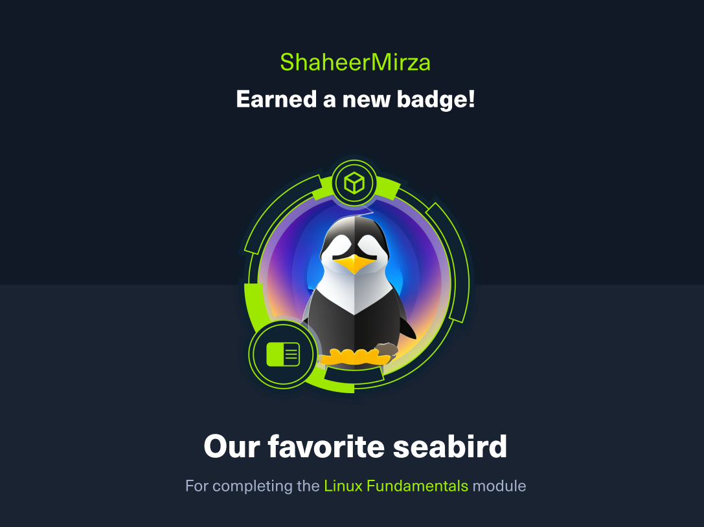</p><p align="center"><strong>HTB Linux Fundamentals</strong><br><sub>Achievement badge</sub></p></td>
<td valign="top" width="33%"><p align="center">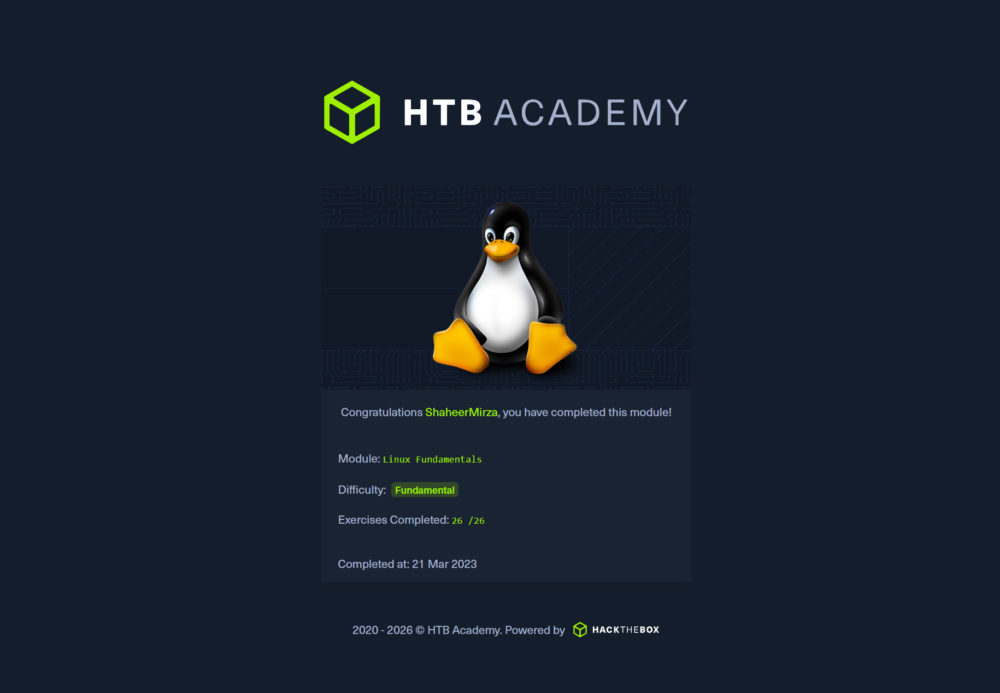</p><p align="center"><strong>HTB Linux Fundamentals</strong><br><sub>Certificate</sub></p></td>
<td valign="top" width="33%"><p align="center">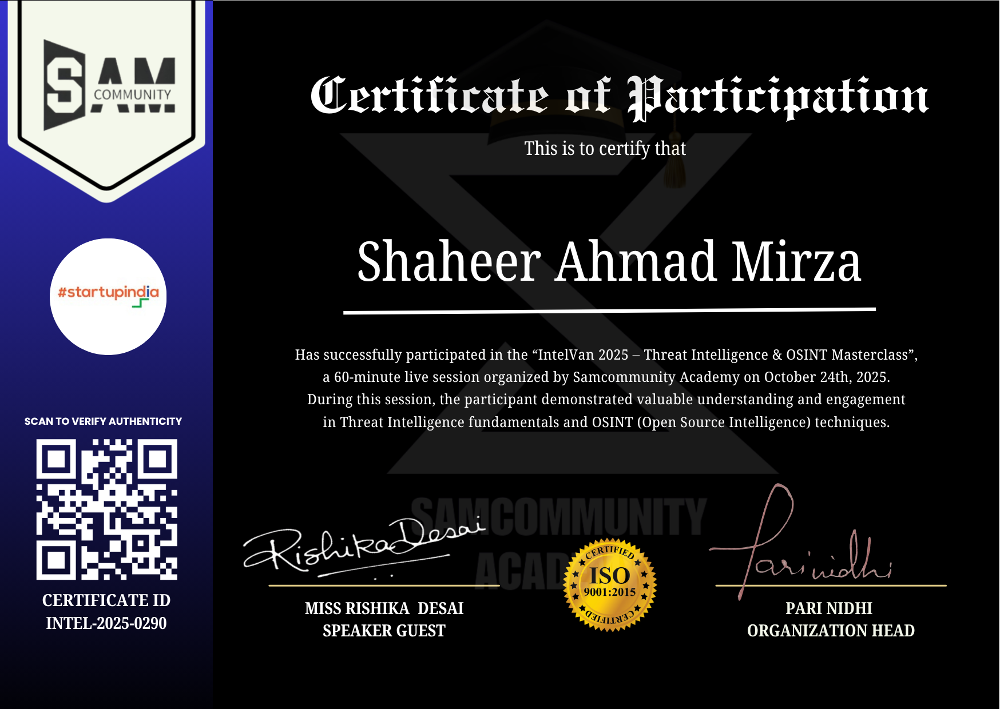</p><p align="center"><strong>Intel 2025-0290</strong><br><sub>Recognition</sub></p></td>
</tr>
</table>

### 🚀 Challenges & programs

<table>
<tr>
<td valign="top" width="33%"><p align="center">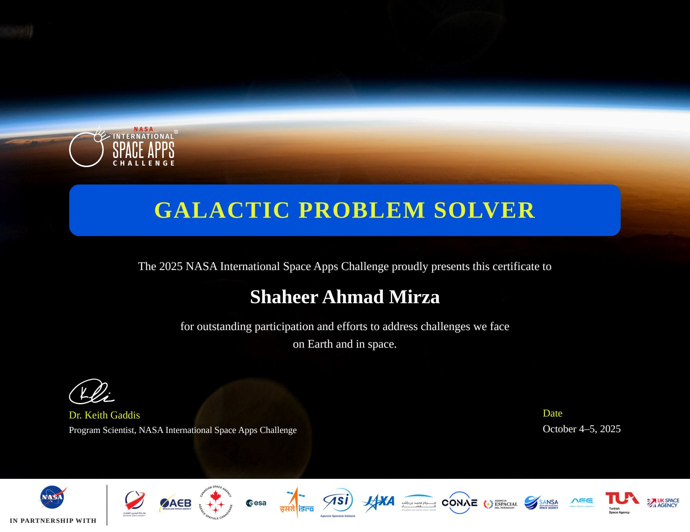</p><p align="center"><strong>NASA Space Apps Challenge 2025</strong></p></td>
<td valign="top" width="33%"><p align="center">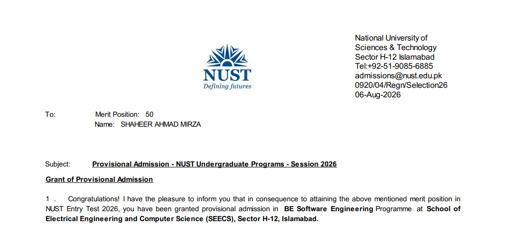</p><p align="center"><strong>NUST Selection</strong><br><sub>Selection letter</sub></p></td>
<td valign="top" width="33%"><p align="center">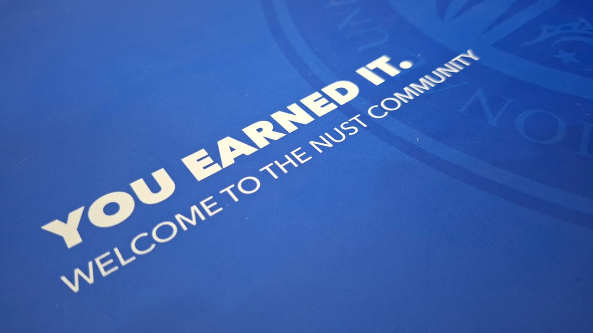</p><p align="center"><strong>NUST</strong><br><sub>Program materials</sub></p></td>
</tr>
</table>

### 🧪 Hack The Box lab milestones

<table>
<tr>
<td valign="top" width="25%"><p align="center">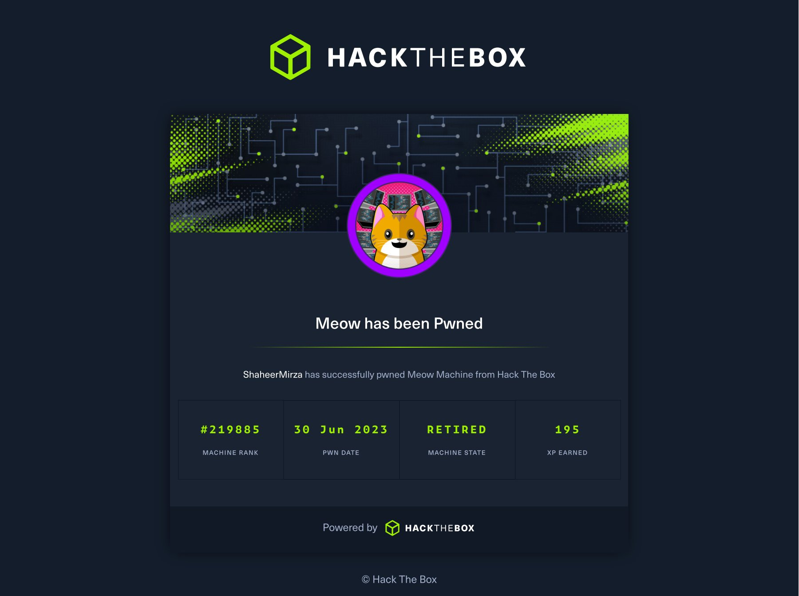</p><p align="center"><strong>Meow</strong></p></td>
<td valign="top" width="25%"><p align="center">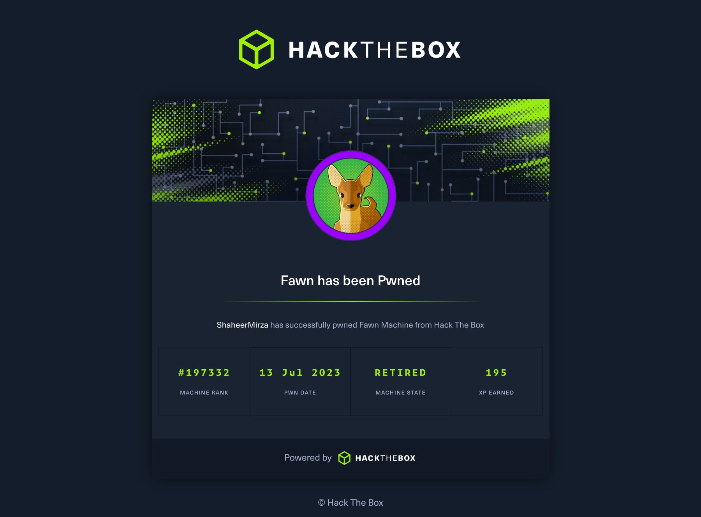</p><p align="center"><strong>Fawn</strong></p></td>
<td valign="top" width="25%"><p align="center">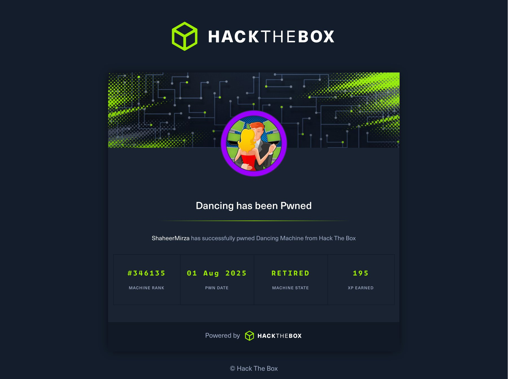</p><p align="center"><strong>Dancing</strong></p></td>
<td valign="top" width="25%"><p align="center">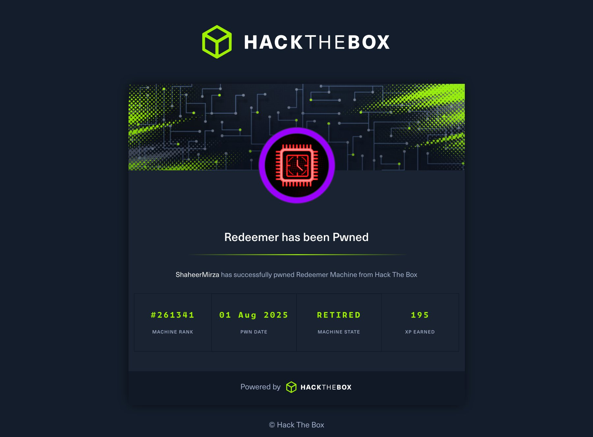</p><p align="center"><strong>Redeemer</strong></p></td>
</tr>
</table>

<details>
<summary><strong>View certificates, transcripts, and write-ups</strong></summary>

- [CrunchLabs Space Selfie certificate](Achievements/Crunch%20Labs/CrunchLabsSpaceSelfieCertificate.pdf)
- [HTB Academy student transcript](Achievements/Hack%20The%20Box/HTB%20Academy%20Student%20Transcript.pdf)
- [HTB Introduction to Networking certificate](Achievements/Hack%20The%20Box/Academy/Introduction%20to%20Networking/Hack%20The%20Box%20Introduction%20to%20Networking.pdf)
- [HTB Linux Fundamentals certificate](Achievements/Hack%20The%20Box/Academy/Linux%20Fundamentals/Hack%20The%20Box%20Linux%20Fundamentals.pdf)
- [Meow write-up](Achievements/Hack%20The%20Box/Labs/Machines/Meow/Meow%20Write-up.pdf) · [certificate](Achievements/Hack%20The%20Box/Labs/Machines/Meow/Meow.pdf)
- [Fawn write-up](Achievements/Hack%20The%20Box/Labs/Machines/Fawn/Fawn%20Write-up.pdf) · [certificate](Achievements/Hack%20The%20Box/Labs/Machines/Fawn/Fawn.pdf)
- [Dancing write-up](Achievements/Hack%20The%20Box/Labs/Machines/Dancing/Dancing%20Write-up.pdf) · [certificate](Achievements/Hack%20The%20Box/Labs/Machines/Dancing/Dancing.pdf)
- [Redeemer write-up](Achievements/Hack%20The%20Box/Labs/Machines/Redeemer/Redeemer%20Write-up.pdf) · [certificate](Achievements/Hack%20The%20Box/Labs/Machines/Redeemer/Redeemer.pdf)
- [NASA Space Apps Challenge 2025 certificate](Achievements/NASA/Space%20Apps%20Challenge/2025/NASA%20Space%20Apps%20Challenge.pdf)

</details>

## 🧰 Toolkit

<div align="center">

</div>

<br>

<div align="center">


</div>

## 📈 Activity

<div align="center">

</div>

## 📫 Let’s connect

- 💼 [LinkedIn](https://www.linkedin.com/in/shaheer--mirza/)
- 🐙 [GitHub](https://github.com/Shaheer-Mirza)
- 👀 [People and projects I follow](https://github.com/Shaheer-Mirza?tab=following)

<div align="center">

### Thanks for visiting — keep exploring, building, and learning. ✦


</div>
